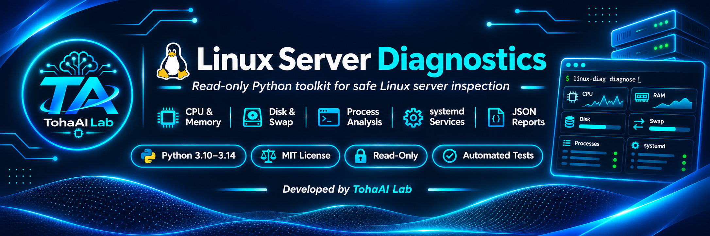

<p align="center">
  
</p>

<br># Linux Server Diagnostics

### Lightweight, read-only Linux server diagnostics toolkit

[](https://github.com/TohaAI-Lab/linux-server-diagnostics/actions/workflows/tests.yml)


Developed by **TohaAI Lab**.

A lightweight Python toolkit designed to collect essential Linux system diagnostics without modifying system configuration, restarting services, or installing additional dependencies.

Built for system administrators, developers, and automation engineers.

---

## Features

| Module | Capabilities |
|---|---|
| CPU Diagnostics | CPU utilization, logical CPU count, load averages |
| Memory Diagnostics | RAM availability, memory utilization, swap usage |
| Disk Inspector | Root filesystem usage and available space |
| Process Inspector | Top processes ranked by resident memory usage |
| Network Inspector | Received and transmitted byte counters |
| Systemd Inspector | Loaded service units and their current states |
| System Information | Operating system, kernel, architecture |
| Report Generator | Structured JSON output with UTC timestamp |
| Error Handling | Partial reports when individual checks fail |

---

## Safety First

The toolkit is designed for read-only diagnostics.

- No service restarts
- No process termination
- No configuration changes
- No package installation
- No external Python dependencies
- No external network requests
- No automatic upload of diagnostic data
- Root privileges are not required for basic diagnostics

The optional systemd inspection uses a read-only service listing command.

---

## Requirements

- Linux operating system
- Python 3.9 or newer
- Access to the Linux /proc filesystem
- systemd is optional

Automated GitHub Actions checks have passed on Python 3.10, 3.11, 3.12, 3.13, and 3.14.

Python 3.9 has not been verified in the current CI matrix.

---

## Installation

Clone the repository:

```bash
git clone https://github.com/TohaAI-Lab/linux-server-diagnostics.git
cd linux-server-diagnostics
```

No additional Python packages are required.

---

## Quick Start

Run basic diagnostics:

```bash
python3 diagnostics.py
```

Include systemd services:

```bash
python3 diagnostics.py --services
```

Display the top 20 processes by memory usage:

```bash
python3 diagnostics.py --top 20
```

Generate compact JSON output:

```bash
python3 diagnostics.py --compact
```

Save a diagnostic report locally:

```bash
python3 diagnostics.py --services > report.json
```

Display available options:

```bash
python3 diagnostics.py --help
```

Check the current version:

```bash
python3 diagnostics.py --version
```

---

## Command-Line Options

| Argument | Description |
|---|---|
| --top N | Number of processes to display, from 0 to 100 |
| --services | Include loaded systemd service units |
| --compact | Generate compact JSON output |
| --version | Display the current version |
| --help | Display command-line help |

The default process limit is 10.

---

## Report Structure

Diagnostic reports are generated in JSON format.

The report contains the following sections:

- version
- timestamp_utc
- system
- cpu
- memory
- disk
- top_processes_by_rss
- network_counters
- systemd (optional)

Reports can be processed by external monitoring tools, automation scripts, or custom applications.

---

## Automated Testing

The repository includes 15 automated unit tests covering:

- CPU calculations
- Memory and swap reporting
- Disk usage calculations
- Process sorting and limits
- Network counters
- Systemd output parsing
- Error handling
- Command-line validation
- JSON output

Run the tests locally:

```bash
python3 -m unittest discover -s tests -v
```

GitHub Actions automatically runs checks on the following Python versions:

| Python Version | CI Coverage |
|---|---|
| 3.10 | Included |
| 3.11 | Included |
| 3.12 | Included |
| 3.13 | Included |
| 3.14 | Included |

[View automated test results](https://github.com/TohaAI-Lab/linux-server-diagnostics/actions)

---

## Privacy

Diagnostic reports may contain process names, process identifiers, systemd unit names, network interface names, and system information.

Review and sanitize reports before sharing them publicly.

The toolkit does not automatically transmit collected information.

---

## Current Limitations

- Linux only.
- Disk diagnostics currently cover the root filesystem.
- Process visibility depends on operating system permissions.
- Network statistics are cumulative byte counters, not live transfer speeds.
- CPU utilization is calculated from a short sampling interval.
- Container environments may report different resource values than the underlying host.
- Systemd parsing is covered by unit tests using mocked output. Further validation on dedicated systemd hosts is planned.
- This toolkit provides diagnostic snapshots rather than continuous monitoring.

---

## Development Roadmap

Planned improvements:

- Additional filesystem diagnostics
- Configurable CPU sampling intervals
- Per-process CPU analysis
- Cgroup resource diagnostics
- Configurable diagnostic thresholds
- Human-readable terminal reports
- HTML report generation
- Extended systemd diagnostics

---

## Contributing

Suggestions, bug reports, and improvements are welcome.

Please include relevant, sanitized diagnostic information when reporting an issue.

---

## License

This project is distributed under the MIT License.

See the LICENSE file for details.

---

## About TohaAI Lab

Independent software development and automation.

- Python Development
- AI Agents
- Telegram Bots
- Browser Automation
- Linux Server Management
- API Integration

[Visit TohaAI Lab on GitHub](https://github.com/TohaAI-Lab)

**Build. Automate. Improve.**
